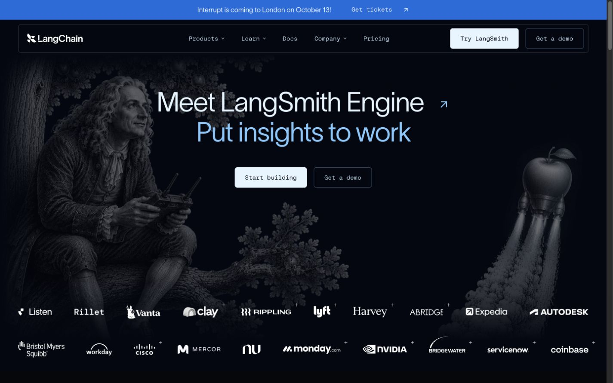
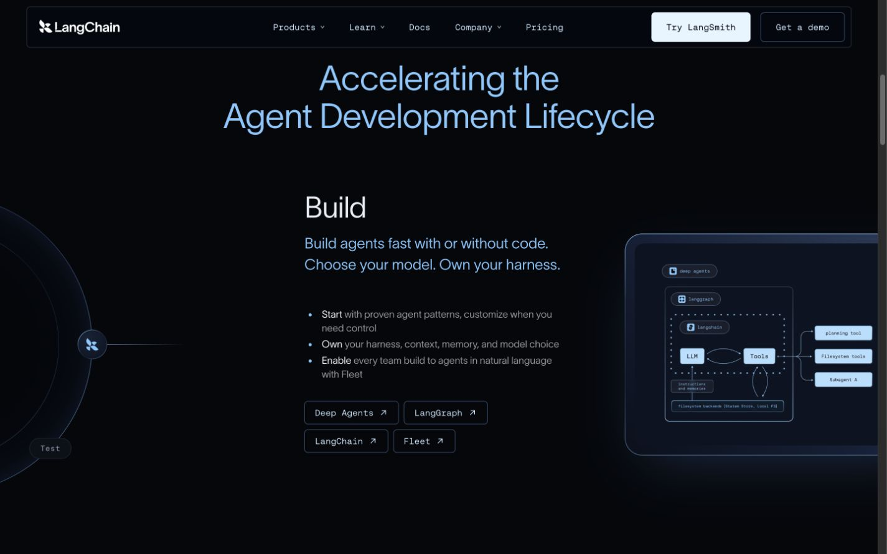
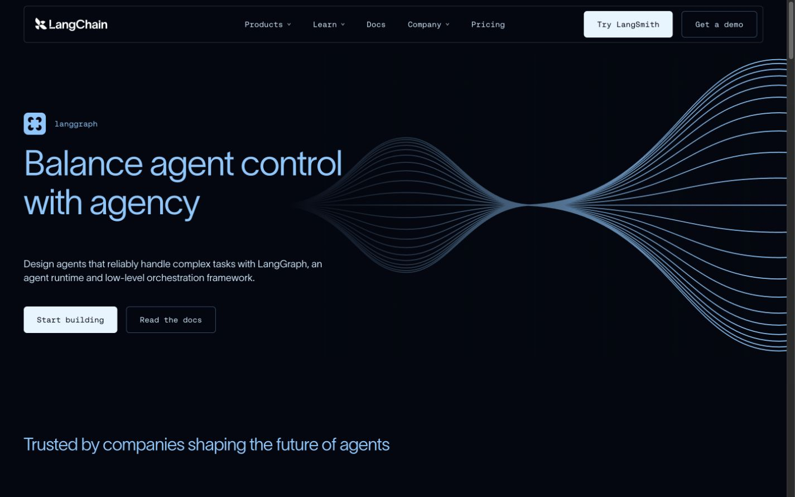
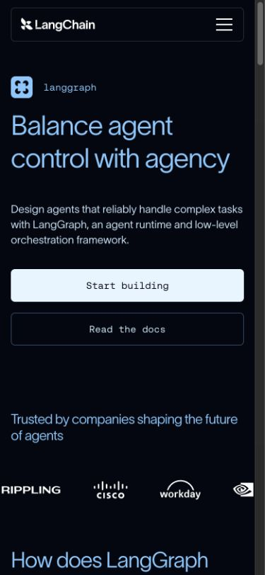
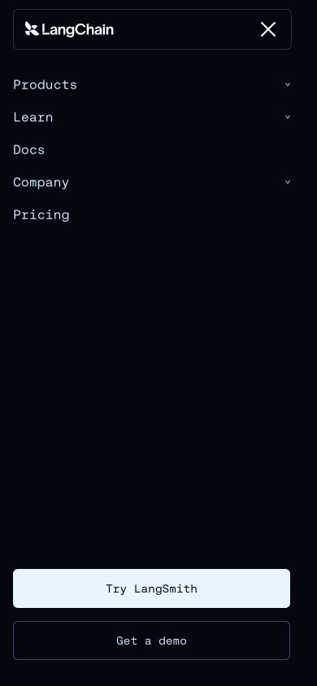

# LangChain / LangGraph 官网页面设计评估

调研日期：2026-10-17。范围：[LangChain 首页](https://www.langchain.com/)与 [LangGraph 产品页](https://www.langchain.com/langgraph)。已在浏览器中检查桌面端（1440 × 900）和移动端（390 × 844）的首屏、页面内容及移动导航。以下技术判断基于页面 DOM、样式和加载资源；未做 Lighthouse 测试。

## 页面观察

| 维度 | LangChain 首页 | LangGraph 产品页 |
| --- | --- | --- |
| 定位与首屏 | 主推 LangSmith Engine；大标题、双按钮、人物与火箭画面、客户标志共同建立焦点与信任。 | 直接说明 LangGraph 的控制能力；左侧标题和按钮，右侧蓝色线条图形。 |
| 内容结构 | 开发流程六阶段 → 开源框架入口 → 客户案例 → 社区数据 → 转化区。 | 能力说明 → 客户标志 → 四项功能展示 → 教程 → 用户评价 → 常见问题 → LangSmith 入口。 |
| 视觉语言 | 近黑底色、浅蓝标题、高亮浅色主按钮；大字号标题配较小的等宽导航与按钮文字。 | 延续同一套颜色和字体；细线、宽留白、左右分栏功能区更突出技术主题。 |
| 移动端 | 首屏标题、双按钮和背景画面纵向排列；画面仍承担主要视觉比重。 | 标题与按钮纵向排列，功能区改为单列；菜单展开后显示分组导航，两个转化按钮位于菜单底部。 |

### 可识别的技术栈

| 类别 | 技术或结论 | 页面证据与判断范围 |
| --- | --- | --- |
| 页面构建 | Webflow | 两页 HTML 均有 `data-wf-domain`、`data-wf-page`、`data-wf-site`；样式从 Webflow 的 `cdn.prod.website-files.com` 加载。 |
| 动效 | GSAP 3.15、ScrollTrigger、SplitText | LangGraph 页加载这些脚本；可确认依赖，具体动画触发方式未逐项验证。 |
| 轮播 | Swiper 12 | LangGraph 页加载 Swiper 12，案例区存在 `swiper-wrapper` 和分页按钮。 |
| 菜单辅助 | Finsweet Attributes `scrolldisable` | 加载 `@finsweet/attributes-scrolldisable@1`；可能用于菜单展开时限制页面滚动，具体调用未验证。 |
| 字体 | Twklausanne、Aeonik、JetBrains Mono | 浏览器计算样式显示前两者分别用于大标题和正文；页面加载 JetBrains Mono 字体资源，等宽字用于导航与按钮。 |
| 组件库 | 未识别 | 浏览器资源和 DOM 中没有足以确认 shadcn/ui、MUI、Ant Design 等组件库的证据；页面可能使用 Webflow 内的自定义组件。 |
| 应用框架 | 未识别 | 现有页面证据不足以确认是否另用 React、Vue 或 Next.js，也不能据此判断完整源码结构。 |

### 关键截图

截图摄于 2026-10-17。首页首屏的宣传文案和人物画面可能随访问时间变化。

**LangChain 首页首屏：**标题、双按钮、叙事画面和导航。

**LangChain 开发流程区：**文字说明、框架入口与右侧示意图的组合。

**LangGraph 桌面端首屏：**左侧价值主张与右侧线条图形。

**LangGraph 移动端首屏与菜单：**标题、按钮重排，以及展开后的导航和转化入口。

| 指标（1–5） | 首页 | LangGraph 页 | 依据 |
| --- | ---: | ---: | --- |
| 视觉辨识度 | 5 | 4 | 首页的叙事画面鲜明；产品页以线条图形表达“控制与流动”。 |
| 信息层级 | 4 | 5 | 产品页从价值主张逐步进入能力、文档和常见问题；首页产品入口较多。 |
| 排版 | 4 | 4 | 大标题与宽留白清晰；部分辅助文字偏小、对比度偏弱。 |
| 交互 | 4 | 4 | 导航分组、案例轮播及移动端菜单明确；悬停细节未逐项验证。 |
| 产品展示 | 3 | 3 | 以概念图与能力说明为主，首屏没有可操作的产品界面。 |
| 移动适配 | 4 | 4 | 两页均能重排，LangGraph 菜单可用；移动端首屏内容较长。 |
| 对 Vago 的适用性 | 3 | 4 | 分层讲述产品能力值得借鉴；开发框架的技术视觉需改写为旅行语境。 |

## 对 Vago 的设计建议

Vago 当前 Web 端是 **React 18、Vite 5、Tailwind CSS 3.4、React Router 6**，现有路由主要是登录后的工作台；未见公开官网路由、组件库或动画库（见 [`package.json`](../../apps/vago-web/package.json)、[`App.jsx`](../../apps/vago-web/src/App.jsx)）。现有配色是浅色页面加靛蓝、紫色按钮（见 [`index.css`](../../apps/vago-web/src/index.css)）。

可考虑两个方向：

1. **旅行叙事**：浅色底、地图与真实行程画面、旅行前中后的连续故事。适合面向旅行用户的公开页面；需要可公开展示且去标识的真实素材。
2. **个人旅行上下文**：深蓝夜色、克制的路径线和时间轴，用真实的计划、行程、足迹、回忆界面说明系统如何组合信息。适合同时展示产品价值与 Agent 能力；需控制深色页面的文字对比度。

**推荐方向 2**。借鉴 LangGraph 的“价值主张 → 具体能力 → 证据 → 下一步”顺序，以及少量线条动效；视觉主体改为 Vago 自己的旅行路径与产品界面。公开页面不应把尚未实现的跨领域重规划、写操作审批或外部工具描述为现有能力，也不展示真实用户的位置与旅行资料。

建议在现有受保护的 `/` 工作台之外新增公开 `/welcome` 页面：导航（产品能力、如何工作、体验入口）→ 首屏（个人旅行上下文与明确按钮）→ 计划／旅行中／回忆三个场景 → 当前真实产品界面 → 个人旅行上下文工作方式 → 隐私与用户确认原则 → 体验入口及页脚。主按钮进入现有登录流程。技术架构可放在可折叠的开发者区域，避免压过旅行体验。

### 初步设计规范（提案，非现有样式）

| 类别 | 建议 |
| --- | --- |
| 色彩 | `--background: #081524`、`--foreground: #F3F7FA`、`--surface: #102337`、`--surface-elevated: #193149`、`--border: #34506A`、`--primary: #8DDDD0`、`--primary-foreground: #082126`、`--muted: #14283A`、`--muted-foreground: #B8C9D3`、`--accent: #F1BA7A`；青绿表示行动，暖色仅用于旅行节点。 |
| 字体 | 沿用现有系统字体，中文与英文标题采用同一套清晰字重；展示标题约 48–64px（移动端 36–40px），正文 16–18px，说明 14px。 |
| 布局 | 内容最大宽度约 1200px；桌面端左右留白至少 32px，移动端 16px；段落与区块间距按 8px 基准递增。 |
| 组件 | 主按钮、次按钮、场景分区、真实界面预览、来源说明和状态标签使用统一规则；避免整页重复同形卡片。 |
| 动效 | 路径线与区块进入动效控制在 200–400ms；支持 `prefers-reduced-motion`，内容不能依赖动画才能读懂。 |

## 实施方案

| 阶段 | 交付与完成标准 |
| --- | --- |
| 1. 页面基础 | 在现有 React/Vite 项目增加公开路由和独立样式变量；不改变受保护路由与登录流程。 |
| 2. 页面内容 | 完成首屏、三个真实场景、产品预览与转化入口；所有能力描述与当前代码一致，展示素材不含个人数据。 |
| 3. 响应式与交互 | 实现桌面和移动布局、键盘可用的菜单、按钮反馈和减少动效偏好；优先用 CSS，只有确实需要时再评估动画依赖。 |
| 4. 验证 | 检查 390px 与 1440px 布局、导航及按钮去向、可读性、构建结果和页面性能；修正发现的问题后交付。 |

悬停动画、辅助技术体验与性能分数未完成专项测试。
