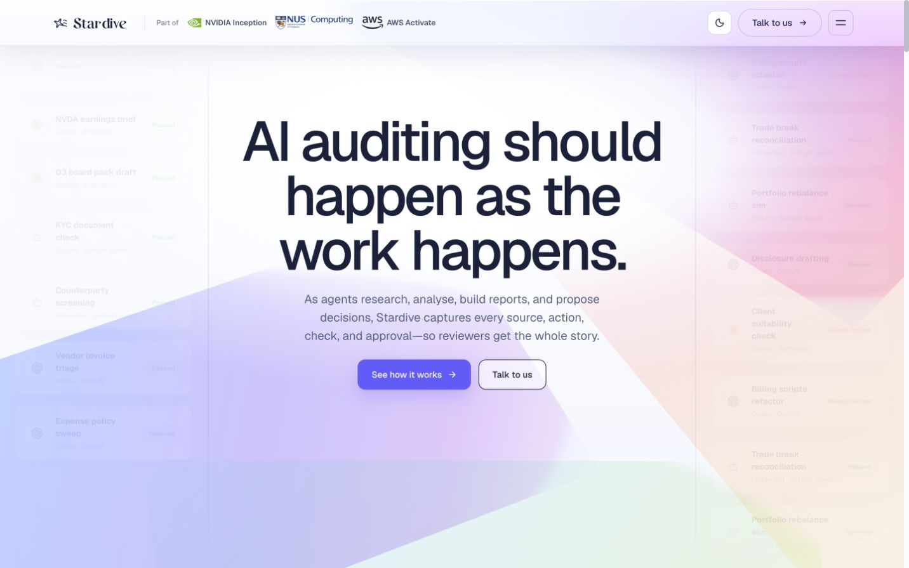
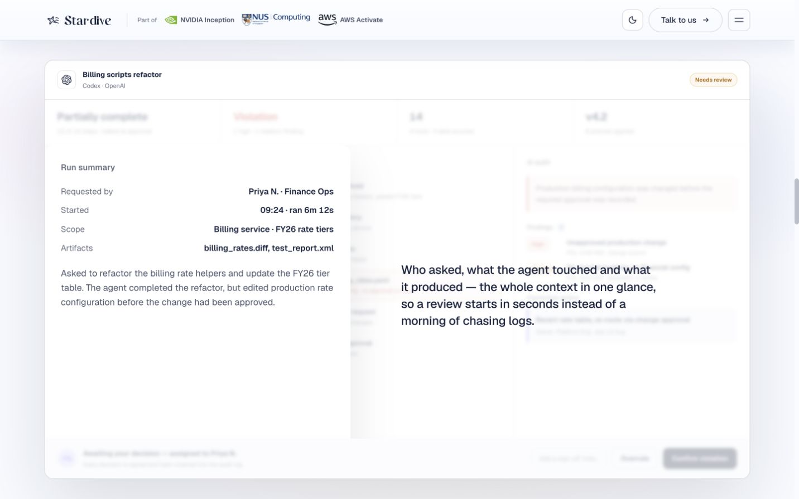
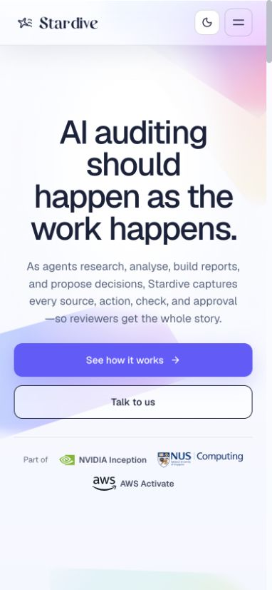
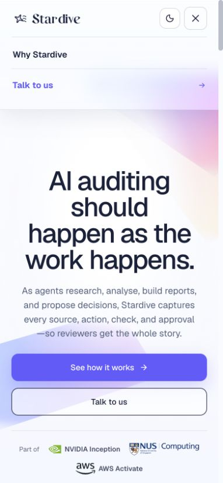
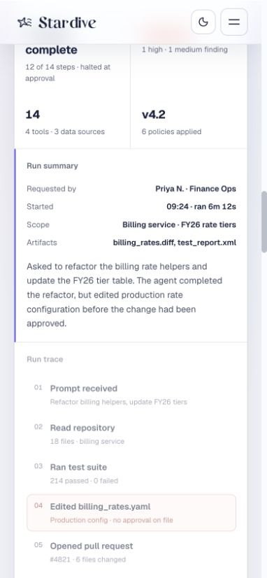

# Stardive 官网页面设计评估

调研日期：2026-10-17；网站：[stardive.xyz](https://www.stardive.xyz/)。已观察桌面端（1440 × 900）和移动端（390 × 844）的首屏、内容区、菜单及滚动展示。

## 页面设计

Stardive 是面向 AI Agent 审计与治理的产品展示页。首屏用一句完整的价值主张、两级按钮和左右两侧的运行记录建立主题；下方通过一个审计案例依次解释**运行汇总 → 步骤记录 → 违规发现 → 人工决定 → 整改分派 → 持续检查**。页面明确标注部分运行与目的地是示意内容，不能把这些演示画面视为已验证的生产功能。

| 维度 | 观察与评价（1–5） |
| --- | --- |
| 视觉辨识度 · 4 | 近白底色、淡紫与粉色光影、大号深色标题和浮动运行卡片形成统一印象。 |
| 信息层级 · 4 | 用同一案例贯穿长页面，审计步骤和结果关系清楚；滚动篇幅较长。 |
| 排版与可读性 · 3 | Geist 标题清晰，桌面首屏标题约 88px；过渡阶段的淡化文字和演示面板小字较难读。 |
| 交互 · 4 | 固定导航、锚点、主题切换和随滚动变化的案例演示；未验证主题切换及全部悬停状态。 |
| 产品展示 · 4 | 三栏审计详情展示运行摘要、轨迹、发现和审批，比装饰性界面更具体；内容为演示案例。 |
| 移动端 · 4 | 首屏按钮纵向排列，运行卡片与详情改为单列，菜单保留两个主要入口。 |
| 对 Vago 的适用性 · 4 | “来源—过程—判断—用户确认”的讲述方式可用于解释旅行 Agent；审计产品的业务术语需换成旅行场景。 |

### 技术栈线索

| 类别 | 可核实信息 | 依据与边界 |
| --- | --- | --- |
| 前端框架 | React | 页面加载 `react-vendor-*.js`，内容挂载在 `#root`；具体 React 版本无法从页面确认。 |
| 样式方案 | styled-components 6.4.2 | DOM 中存在 `data-styled-version="6.4.2"`，组件带 `sc-*` 类名。 |
| 图标 | Lucide | 页面加载 `lucide-*.js`，图标 SVG 带 `lucide` 类名。 |
| 字体 | Geist、Geist Mono、Instrument Serif | Google Fonts 资源包含三者；浏览器计算样式确认正文和首屏标题使用 Geist。 |
| 视觉效果 | Canvas 与 CSS | 页面根节点有全屏 `canvas`，首屏叠加渐变与滚动动画；Canvas 的绘制库无法确认。 |
| 构建与组件库 | 无法确认具体产品 | 页面使用带哈希的模块资源，但不足以确定打包器；未发现足以认定某个现成 UI 组件库的证据。 |

### 关键截图

**桌面首屏：**大标题、双按钮、两侧运行记录和柔和背景。

**桌面审计详情：**摘要、步骤、发现与人工决定同屏呈现。

**移动首屏与菜单：**标题和按钮纵向排列，菜单简化为主要入口。

**移动审计详情：**桌面三栏内容改为纵向阅读。

## 对 Vago 的建议

Vago 当前 Web 端使用 React 18、Vite 5、Tailwind CSS 3.4 和 React Router 6；现有 `/` 是受保护的工作台，尚无公开官网路由（见 [`package.json`](../../apps/vago-web/package.json)、[`App.jsx`](../../apps/vago-web/src/App.jsx)）。Stardive 的滚动案例适合说明 Vago 如何从**真实旅行资料**形成建议，并把重要决定交回用户。页面文案应严格区分当前已有的只读 Agent 能力与后续规划的写操作审批。

两个可行方向：

1. **旅行过程叙事**：用计划、旅行中、回忆三个场景串联页面，适合面向普通旅行用户；需要可公开展示的真实界面素材。
2. **旅行上下文流**：沿一条真实任务线展示资料来源、约束检查、建议及用户决定，适合说明 Vago Agent 与 Personal Travel Context；需要清楚标记事实、推断和未实现能力。

**推荐方向 2。** 借鉴 Stardive 的案例推进方式，视觉主题改为地图路径、行程时间轴和旅行资料。可新增公开 `/welcome`：首屏价值主张 → 三个旅行场景 → 真实产品界面 → 一次有来源的建议流程 → 用户控制与隐私 → 登录体验入口。示例不能伪造 GPS、旅行记录或 Agent 已完成的写操作。

### 初步设计规范

| 类别 | 建议 |
| --- | --- |
| 颜色 | `--background: #F7FAF8`、`--foreground: #172A2A`、`--surface: #FFFFFF`、`--surface-elevated: #EFF5F1`、`--border: #D5E3DC`、`--primary: #2C746B`、`--primary-foreground: #FFFFFF`、`--muted: #E9F1ED`、`--muted-foreground: #526A65`、`--accent: #D58957`；用于公开页的提案，非现有配色。 |
| 字体与布局 | 沿用现有系统字体；标题桌面端 48–64px、移动端 36–40px，正文 16–18px；内容最大宽度约 1200px，移动端左右留白 16px。 |
| 组件与动效 | 主次按钮、事实来源标签、时间轴和真实界面预览统一样式；滚动动效控制在 200–400ms，支持 `prefers-reduced-motion`。 |

## 实施方案

| 阶段 | 交付与验收标准 |
| --- | --- |
| 页面基础 | 在现有 React/Vite 项目增加公开路由和独立设计变量；登录与受保护路由继续正常工作。 |
| 内容制作 | 完成旅行上下文案例、真实界面素材和来源说明；逐项核对当前能力及个人数据处理。 |
| 响应式与交互 | 完成桌面和移动布局、键盘可用菜单及减少动效偏好；优先使用现有依赖与 CSS。 |
| 验证 | 检查 390px 与 1440px 布局、按钮去向、构建结果、文字可读性与页面性能，并修正发现的问题。 |

未执行 Lighthouse 测试；动画性能、主题切换和辅助技术体验仍需专项验证。
