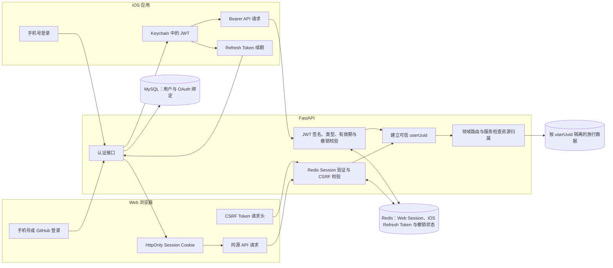

# 登录与身份认证设计

> 本文与当前双端认证代码保持一致；未来能力会单独注明。

## 设计目标

Vago 为 Web 与 iOS 提供一致的用户身份、账号状态检查和数据归属校验。Web 使用服务端 Redis Session，通过 `HttpOnly` Cookie 传递随机会话标识；iOS 使用 Keychain 保存 JWT，通过 `Authorization: Bearer` 请求头访问 API。两端采用各自的凭证传递方式，最终都由 FastAPI 建立经过验证的 `userUuid`，并将其传给领域服务。客户端提交的用户标识不作为授权依据。

认证主体保存在 MySQL `users` 表。`uuid` 是对外使用的用户标识；自增 `id` 用于数据库内部关联。手机号、邮箱和第三方账号绑定用于登录身份查找，用户服务统一检查账号状态。用户资料、个人偏好、旅行记录、足迹、知识、回忆、会话和规划候选均按经过认证的 `user_uuid` 查询和校验资源归属。

## 快速了解

| 方案组成部分 | 作用 |
| --- | --- |
| MySQL `users` | 保存账号身份与状态；服务端据此确认用户是否仍可登录。 |
| Redis Session | 保存 Web 会话、过期时间和 CSRF Token；退出登录时删除会话，使 Cookie 立即失效。 |
| `HttpOnly` Cookie | 在 Web 浏览器中传递随机 Session ID，页面脚本无法读取该凭证。 |
| `Secure` 与 `__Host-` Cookie 前缀 | 非本地环境要求 HTTPS 传输，并限制 Cookie 的作用范围；本地 HTTP 调试使用 `vago_session`。 |
| `SameSite=Lax` | 限制浏览器在跨站请求中携带 Web 会话 Cookie；不能代替 CSRF 校验。 |
| CSRF Token 与 `X-CSRF-Token` | Web 写请求提交会话内的令牌，后端核对后才允许修改数据。 |
| `Origin` 校验与凭证 CORS | 限制 Web 登录及携带 Cookie 的写请求来源；仅允许配置过的 Web 来源。 |
| JWT access token 与 `Authorization: Bearer` | iOS 在受保护请求中携带；后端校验签名、有效期、令牌类型和撤销状态。 |
| JWT refresh token | iOS 在 access token 过期后提交，用于换取新的令牌对；后端通过 Redis 校验并轮换，旧令牌不能重复使用。 |
| iOS Keychain | 保存 iOS 的 access token 和 refresh token，避免令牌进入普通应用存储。 |
| OAuth `state` | GitHub 登录回调时核对发起请求的状态，防止授权结果被错误关联。 |

## 登录方式

### 手机号与短信验证码

Web 与 iOS 均支持手机号验证码登录。后端生成六位验证码，将验证码和发送频率限制写入 Redis。验证码有效期为 300 秒，同一手机号的发送间隔为 60 秒；登录校验成功后立即删除验证码，避免验证码重复使用。

手机号首次登录会创建用户和默认设置。显式手机号注册接口可在验证码校验后创建用户并设置昵称。当前代码没有密码登录流程，短信服务商尚未接入；仅 `local` 开发环境会将手机号和验证码写入应用日志，非本地环境不记录验证码。正式上线前仍需接入短信服务商。

### GitHub OAuth

Web 支持 GitHub OAuth。浏览器生成随机 `state` 并保存在 `sessionStorage`，回调时核对 `state`，再把授权码和回调地址发送至 Vago 后端。后端使用服务端 GitHub 凭据换取第三方访问令牌并读取用户资料。后端按 provider 与 GitHub 用户标识查找绑定；已有绑定时登录对应用户，未绑定时尝试按邮箱关联现有用户，否则创建新用户。

OAuth 登录请求明确标记客户端类型，以便后端按 Web 或 iOS 的认证方式完成登录。后端仅允许配置过的 provider。iOS 当前登录界面使用手机号验证码流程。

## Web 认证设计

### 会话凭证

Web 登录成功后，后端生成高熵、不可预测的随机 Session ID，在 Redis 中建立 Session 记录，并通过 `Set-Cookie` 返回 Session ID。浏览器 Cookie 使用以下属性：

- 非本地环境名称使用 `__Host-vago_session`；本地 HTTP 调试环境使用 `vago_session`。
- 非本地环境设置 `Secure`、`HttpOnly` 和明确的 `SameSite=Lax`；本地 HTTP 仅关闭 `Secure`。
- 设置 `Path=/`，不设置 `Domain`。
- 设置与服务端 Session 一致的过期时间。

Web 登录响应只返回必要的用户资料与登录结果，不向 JavaScript 返回 access token 或 refresh token。Web 不在 `localStorage`、`sessionStorage`、IndexedDB 或其他可由页面脚本读取的位置保存认证凭证。用户展示资料可保存在前端内存中；页面重载后通过会话查询接口恢复登录状态。

Session ID 只用于定位服务端会话。Redis Session 记录至少关联 `userUuid`、会话创建时间、最后活动时间、绝对过期时间和 CSRF Token。Session ID 不承载用户资料或授权声明。认证成功时生成全新的 Session ID，不接受客户端指定的 Session ID，避免会话固定。

Redis 使用共享部署，供所有 FastAPI 实例读取同一份 Web Session。服务端执行空闲超时和绝对超时；Cookie 过期时间不能替代服务端过期校验。Session 缺失时返回 401；Redis 不可用时返回 503，受保护请求不会放行。

当前空闲超时默认 7 天、绝对超时默认 30 天。`WEB_SESSION_IDLE_SECONDS`、`WEB_SESSION_ABSOLUTE_SECONDS` 可配置。`WEB_COOKIE_SECURE` 留空时按 `ENVIRONMENT` 决定：`local` 环境允许 HTTP 调试，其他环境强制 HTTPS Cookie。

### 登录、恢复、续期与退出

Web 手机号登录、注册和 OAuth 登录成功后，后端创建 Redis Session、轮换 Session ID、设置安全 Cookie，并返回用户资料。前端通过会话查询接口读取当前用户与 CSRF Token，根据返回结果更新内存中的登录状态。

页面启动或刷新时，前端调用会话查询接口。后端从 Cookie 取得 Session ID，在 Redis 中验证 Session 状态、账号状态及过期时间；有效时返回用户资料和 CSRF Token，无效时返回未认证结果。前端不依据本地存储中的 token 判断登录状态。

Web API 请求由浏览器自动携带同源 Cookie。受保护请求的服务端认证依赖读取 Cookie、验证 Redis Session，并由 Session 关联的 `userUuid` 建立当前用户身份。响应为 401 时，前端清除内存登录状态并转到登录页；Web Session 不通过 JWT refresh 接口续期。

Web 退出登录时，前端提交 CSRF Token。后端删除 Redis 中的当前 Session 并清除 Cookie，Cookie 清除时使用与创建时一致的名称、Path 和安全属性。删除 Redis Session 后，已复制的 Session ID 立即失效。

用户封禁、注销或其他禁止登录的状态变化必须阻止已有 Web Session 继续访问受保护 API。认证方式变更、账号安全处置等需要撤销会话的操作，应删除该用户受影响的 Redis Session。

### CSRF 与来源校验

浏览器会自动附带 Cookie，因此所有使用 Web Session 的状态变更请求都必须验证 CSRF Token。后端在 Session 中保存 CSRF Token；会话查询接口将其返回给前端，前端仅保存在内存中，并通过专用请求头（例如 `X-CSRF-Token`）提交。服务端对写请求、登出和其他会改变认证状态的请求检查该值。

对于 Web 登录、注册、OAuth 登录和使用 Cookie 认证的写请求，后端校验 `Origin`；缺失或不在已配置来源中时拒绝。`SameSite=Lax` 和 CORS 来源限制作为额外防护，不替代 CSRF Token 校验；OAuth 回调继续验证 `state`。

Web 与 API 通过同源路径 `/api/...` 部署时，浏览器按同源规则发送 Cookie。当前 Vite 通过 `/api/v1` 同源代理转发，前端请求显式启用凭证传递；后端仅允许明确列出的 Web 来源，并启用凭证 CORS。当前 Cookie 使用 `SameSite=Lax`，因此跨站部署尚未开放；若未来确需跨站调用，须另行配置 `SameSite=None; Secure` 并保留 CSRF Token 和来源校验。

## iOS 认证设计

iOS 使用共享 `SessionStore` 管理 `launching`、`signedOut` 和 `signedIn` 状态。登录成功后，后端签发 HS256 access token 与 refresh token；iOS 将令牌对保存在 Keychain，令牌不暴露给视图层。JWT 包含 `userUuid`、内部 `userId`、令牌类型 `typ`、签发时间 `iat`、过期时间 `exp` 和会话标识 `sid`。

- **Access token**：默认有效期为 7,200 秒，用于访问受保护 API。
- **Refresh token**：默认有效期为 2,592,000 秒，用于换取新的令牌对。
- **会话标识 `sid`**：区分设备登录会话。iOS 提交稳定设备标识；服务端据此建立独立会话。

Redis 按用户和 `sid` 保存当前 refresh token。刷新时，后端验证 JWT 签名、有效期、`typ=refresh`、用户状态以及 Redis 中保存的令牌值，然后签发新的令牌对并替换旧值。旧 refresh token 不可重复使用。

iOS API 客户端使用 `Authorization: Bearer <accessToken>`。受保护请求收到 401 后，调用 refresh 接口、更新 Keychain 中的令牌对，并重放原请求一次。并发请求共享同一个刷新任务，避免同时轮换 refresh token。退出登录时，iOS 向后端提交 access token 和 refresh token；后端将 access token 加入 Redis 黑名单并删除当前会话的 refresh token，随后客户端删除 Keychain 令牌和本地资料缓存。

应用启动时，iOS 读取 Keychain。若存在与当前会话绑定的本地资料，先显示主界面，再以 5 秒请求超时验证服务端资料。服务端明确拒绝会话时清理凭证；网络或服务暂时不可用时保留凭证和缓存，并标明当前使用本地资料。资料缓存只保存会话标识或刷新令牌摘要与最小展示资料，不保存原始令牌。首次使用新版缓存时，旧版未绑定会话的资料需成功联网验证后更新，不能直接用于离线首屏。

## FastAPI 认证与授权边界

FastAPI 为 Web Session 与 iOS JWT 提供明确的认证入口：

- Web 请求使用 `__Host-vago_session` Cookie 查询 Redis Session。
- iOS 请求使用 `Authorization: Bearer <JWT>` 验证令牌签名、有效期、令牌类型和撤销状态。
- 请求明确使用某种凭证时，凭证无效即拒绝请求；不得在一种凭证无效时静默改用另一种凭证。
- 两种认证方式都只建立服务端可信的 `userUuid`。领域路由将该身份注入服务层，服务层负责业务规则、ownership 校验和持久化。
- Agent Runtime 通过有明确输入输出的内部 Domain Tools 使用领域能力，不绕过领域服务直接操作数据库。

账号状态至少包括正常、封禁和注销中。登录、Session 验证及 JWT 刷新都检查账号状态。用户禁用或软删除由 MySQL 用户记录表达；Web Redis Session 与 iOS refresh token 按各自会话规则撤销。

## 会话撤销与故障处理

- Web Session 的过期、登出和安全撤销由 Redis 中的 Session 记录控制。清除浏览器 Cookie 只负责删除客户端副本，不能代替服务端撤销。
- iOS refresh token 由 Redis 按用户和设备会话保存；iOS 登出时删除对应记录。access token 黑名单有效期不超过该令牌剩余有效期。
- Web Redis Session 验证失败或 Redis 不可用时，拒绝 Web 受保护请求，不允许跳过会话校验。
- JWT 验证失败、令牌类型不符、令牌过期或撤销状态不通过时，拒绝 iOS 受保护请求。
- 认证日志不得记录短信验证码、Cookie 值、完整 JWT、refresh token 或原始 GPS 坐标。日志仅记录排查所需的请求标识、用户标识（按日志规范处理）和认证结果。

## 主要代码入口

| 职责 | 代码 |
| --- | --- |
| 认证路由与 schema | `services/vago-ai/app/auth/router.py`、`services/vago-ai/app/auth/schemas.py` |
| 登录、令牌签发、刷新与注销 | `services/vago-ai/app/auth/service.py` |
| GitHub OAuth 换码与用户资料读取 | `services/vago-ai/app/auth/oauth.py` |
| Web Session 存取与 CSRF 校验 | `services/vago-ai/app/auth/web_session.py` |
| Web Cookie / iOS JWT 验证与当前用户身份 | `services/vago-ai/app/dependencies/auth.py` |
| 用户状态、资料与 OAuth 绑定 | `services/vago-ai/app/users/service.py`、`services/vago-ai/app/users/models.py` |
| Web 登录状态与认证请求 | `apps/vago-web/src/stores/auth.js`、`apps/vago-web/src/pages/LoginPage.jsx`、`apps/vago-web/src/api/` |
| iOS 会话、令牌续期与请求 | `apps/vago-ios/VagoIOS/Core/APIClient.swift`、`apps/vago-ios/VagoIOS/Core/KeychainStore.swift` |
