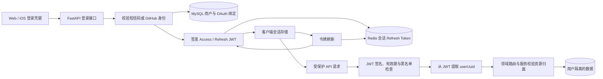

# 登录与身份认证设计

> 状态：根据当前代码整理，2026-10-17。本文说明 Vago 当前认证架构；接口行为以 FastAPI schema、依赖和服务实现为准。

## 设计边界

Vago 使用后端认证的用户身份作为个人数据访问依据。客户端负责收集登录凭据、保存登录会话并在请求中携带访问令牌；FastAPI 验证令牌后，从其中取得 `userUuid`，再将该身份传给用户、行程、知识、足迹和 Agent 等领域服务。客户端提交的用户标识不作为授权依据。

认证主体保存在 MySQL `users` 表。`uuid` 是对外使用的用户标识；自增 `id` 用于数据库内部关联。手机号、邮箱和第三方账号绑定分别用于登录身份查找，账号状态由用户服务统一检查。

## 登录方式

### 手机号与短信验证码

Web 与 iOS 均提供手机号验证码登录。后端生成六位验证码，将验证码和发送频率限制写入 Redis。验证码有效期为 300 秒，同一手机号的发送间隔为 60 秒；登录校验成功后立即删除验证码，防止重复使用。

手机号首次登录会自动创建用户和默认设置。另有显式手机号注册接口，可在验证码校验后创建用户并设置昵称。当前代码没有密码登录流程，真实短信服务商尚未接入；验证码发送实现会将手机号和验证码写入应用日志，属于当前实现状态，不能视作生产短信交付方案。

### GitHub OAuth

Web 支持 GitHub OAuth。浏览器先生成随机 `state` 并保存在 `sessionStorage`，回调时核对 `state`，随后把授权码和回调地址发送至 Vago 后端。后端使用服务端 GitHub 凭据换取第三方访问令牌，再读取 GitHub 用户资料。后端按 provider 与 GitHub 用户标识查找绑定；已有绑定时登录对应用户，未绑定时尝试按邮箱关联现有用户，否则创建新用户。

当前后端仅允许 `github` provider。iOS 登录界面当前使用手机号验证码流程。

## 令牌与服务端会话

登录成功后，后端签发一对 HS256 JWT：

- **Access token**：有效期默认 7,200 秒，用于访问受保护 API。
- **Refresh token**：有效期默认 2,592,000 秒，用于换取新的令牌对。
- **会话标识 `sid`**：按设备会话区分刷新凭据。iOS 发送稳定设备标识；没有设备标识的登录请求由服务端生成会话标识。

令牌包含 `userUuid`、内部 `userId`、令牌类型 `typ`、签发时间 `iat` 和过期时间 `exp`；存在会话标识时还包含 `sid`。JWT 密钥通过 `JWT_SECRET_KEY` 配置，服务端使用同一密钥验证签名。

Redis 保存每个用户和会话对应的当前 refresh token。刷新时，后端验证签名、有效期、`typ=refresh`、用户状态以及 Redis 中保存的令牌值，然后签发新的令牌对并替换该会话的 refresh token。旧 refresh token 因与 Redis 当前值不符而不能再次使用。不同设备的 refresh token 使用不同会话键保存。

退出登录时，后端将当前 access token 的摘要加入 Redis 黑名单，保留时间不超过该令牌剩余有效期；若请求同时携带 refresh token，则删除对应设备会话的 Redis refresh token。access token 黑名单用于令牌有效期内即时撤销访问。

## 受保护请求与用户归属

FastAPI 的 `get_current_user_uuid` 依赖从配置的认证请求头读取令牌，并兼容 `Bearer` 前缀。依赖验证 HS256 签名与过期时间，检查 access token 黑名单，并从 JWT 的 `userUuid` 提取当前用户身份。各领域路由将该身份注入服务层；服务层按 `user_uuid` 查询和校验资源归属。用户资料、个人偏好、旅行记录、足迹、知识、回忆、会话和规划候选均采用此模式。

账号状态包括正常、封禁和注销中。登录与令牌刷新时会检查账号状态；用户资料等领域操作也会通过用户服务检查状态。账号禁用和软删除由 MySQL 用户记录表达。

## Web 与 iOS 会话

### Web

Web 将 access token、refresh token 和用户资料写入 `localStorage` 的 `vago_auth` 项；登录页也分别写入 `accessToken` 和 `refreshToken` 两个键，API 客户端从这些键或 `vago_auth` 读取 access token，并放入 `authorization` 请求头。后端兼容无 `Bearer` 前缀的令牌。

受保护路由根据本地是否存在 access token 控制页面跳转。服务端仍对 API 独立验证令牌。当前 Web API 客户端收到 401 后会清理本地令牌并跳转登录页，没有调用后端 refresh 接口自动续期。Web 注销请求只发送 access token，后端因此拉黑 access token；Web 随后清除本地保存的 refresh token。

### iOS

iOS 由共享 `SessionStore` 管理 `launching`、`signedOut` 和 `signedIn` 状态。令牌对保存在 Keychain，访问令牌不暴露给视图层。应用启动时读取 Keychain；如果存在与当前会话绑定的本地资料，先进入主界面，再以 5 秒请求超时验证服务端资料。服务端明确拒绝会话时清理凭证；网络或服务暂时不可用时保留凭证和缓存，并标明当前使用本地资料。资料缓存只保存会话标识或刷新令牌摘要与最小展示资料，不保存原始令牌。首次使用新版缓存时，旧版未绑定会话的资料需成功联网验证后更新，不能直接用于离线首屏。

iOS API 客户端使用 `Authorization: Bearer <token>`。受保护请求收到 401 后，会调用 refresh 接口、更新 Keychain 中的令牌对并重放原请求一次。并发请求共享同一个刷新任务，避免多个请求同时轮换 refresh token。退出登录时客户端向后端提交 access token 和 refresh token，清理服务端当前会话，然后删除 Keychain 令牌和本地资料缓存。

## 当前实现边界

- JWT 验证依赖当前检查签名、过期时间、黑名单和 `userUuid`，没有检查受保护请求令牌的 `typ` 是否为 `access`。
- Redis 黑名单查询发生异常时，当前认证依赖记录警告并继续放行请求；Redis 中的 refresh token 校验和登录短信码存取则需要 Redis 正常工作。
- Web 与 iOS 的续期及注销行为并不一致：iOS 自动续期并向服务端撤销 refresh token；Web 401 时直接清理登录态，注销请求没有提交 refresh token。
- 短信验证码仍由后端临时生成和缓存，短信服务商集成尚未实现；当前发送函数记录明文手机号与验证码。
- Web OAuth 回调使用 `state` 校验；GitHub OAuth 授权码由后端持有服务端密钥完成换码。OAuth 绑定表当前保存第三方 access token 与过期时间。

这些是当前代码行为的记录，用于区分现有实现与完整的认证安全目标。

## 主要代码入口

| 职责 | 代码 |
| --- | --- |
| 认证路由与 schema | `services/vago-ai/app/auth/router.py`、`services/vago-ai/app/auth/schemas.py` |
| 登录、令牌签发、刷新与注销 | `services/vago-ai/app/auth/service.py` |
| GitHub OAuth 换码与用户资料读取 | `services/vago-ai/app/auth/oauth.py` |
| JWT 请求验证与当前用户身份 | `services/vago-ai/app/dependencies/auth.py` |
| 用户状态、资料与 OAuth 绑定 | `services/vago-ai/app/users/service.py`、`services/vago-ai/app/users/models.py` |
| Web 会话与登录 | `apps/vago-web/src/stores/auth.js`、`apps/vago-web/src/pages/LoginPage.jsx`、`apps/vago-web/src/api/user.js` |
| iOS 会话、令牌续期与请求 | `apps/vago-ios/VagoIOS/Core/APIClient.swift`、`apps/vago-ios/VagoIOS/Core/KeychainStore.swift` |
